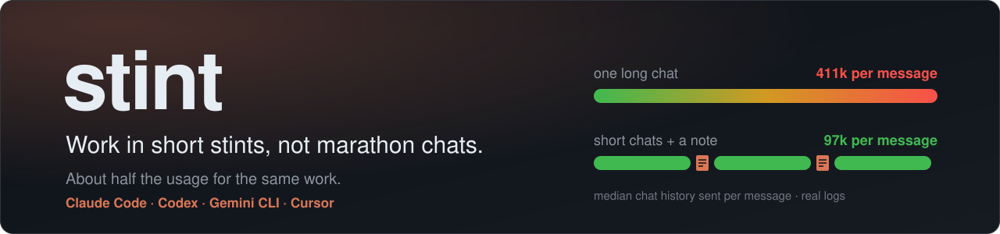
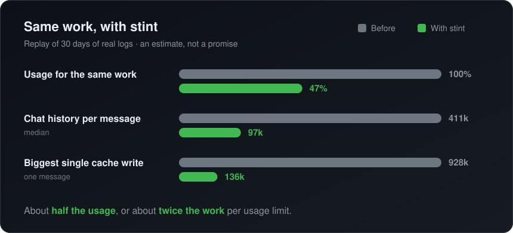
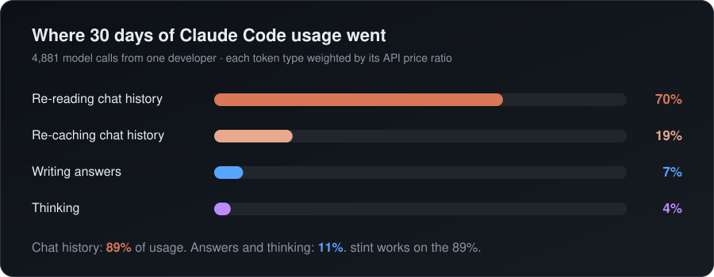
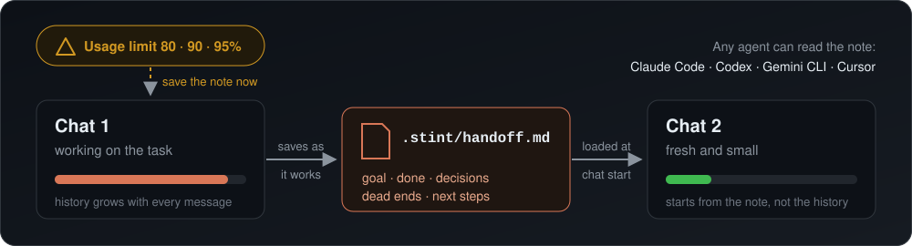
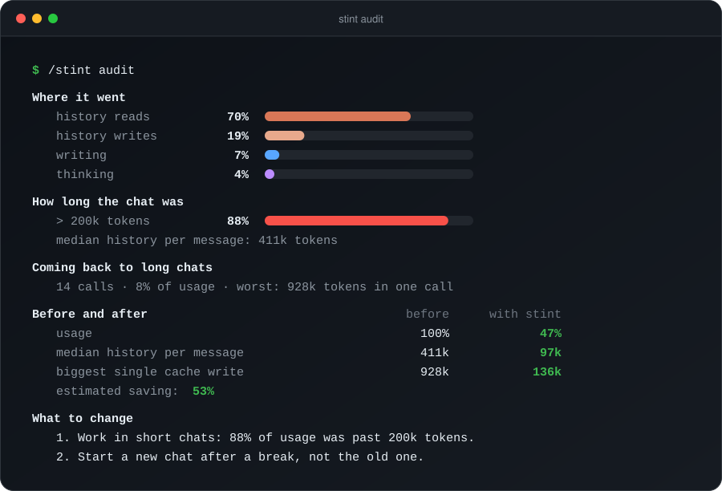
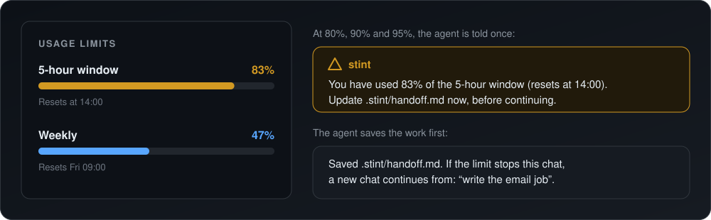

<div align="center">



<br>

[](https://github.com/mrmajdi/stint/actions/workflows/ci.yml)
[](LICENSE)
[](#claude-code)
[](#other-agents)
[](#privacy)

**[Install](#install)** · **[How it works](#how-stint-works)** · **[Commands](#use)** · **[Audit](#the-audit)** · **[FAQ](#faq)**

</div>

<br>

AI coding agents re-read the whole chat on every message. Long chats get expensive fast. **stint keeps chats short.** It saves the state of your work in a small note. Each new chat starts from that note, not from a huge history.

<p align="center">
  
</p>

> [!NOTE]
> These numbers come from replaying 30 days of real Claude Code logs from one developer (the author). They are an estimate, not a promise. Run `/stint audit` to see your own numbers.

## What you get

<table>
<tr>
<td width="50%" valign="top">

### 📝 A handoff note

The agent keeps a short note in `.stint/handoff.md`: goal, what is done, decisions, dead ends and next steps. It saves **while it works**, not only at the end.

</td>
<td width="50%" valign="top">

### 🔁 Fresh chats that remember

A new chat gets the note at once. The agent says what it is resuming and continues. You do not explain the task again.

</td>
</tr>
<tr>
<td width="50%" valign="top">

### ⚠️ Usage limit warnings

At **80%, 90% and 95%** of your 5-hour or weekly limit, the agent saves the note before the limit can stop the chat.

</td>
<td width="50%" valign="top">

### 📊 A usage audit

`/stint audit` reads your local logs. It shows where your usage goes and how much stint could save **for you**.

</td>
</tr>
<tr>
<td colspan="2" valign="top">

### 🧠 Works with graphify

If your project has a [graphify](https://github.com/Graphify-Labs/graphify) knowledge graph, stint tells every new chat about it. The agent can answer code questions from the graph instead of reading many files again, so a fresh chat stays small. [How to set it up](#graphify).

</td>
</tr>
</table>

## The problem

Your usage limit does not go to your questions or to the code the agent writes. It goes to the **chat history**.

1. **Every message re-sends the whole chat.** In a 400k-token chat, the history part of each message costs 10 times more than in a 40k-token chat.
2. **Coming back after a break is worse.** Claude Code keeps the chat history in a cache: for one hour on a Claude subscription, for five minutes with an API key. After that, your next message writes the whole history into the cache again. One message can use a big part of your 5-hour limit at once.
3. **You cannot see it happen.** The agent cannot see your usage meter either. When the limit stops the chat, your work state is lost.

<p align="center">
  
</p>

The same 30-day audit also found:

- **88%** of the usage was spent while the chat was over 200k tokens.
- One "welcome back" message after a break re-cached up to **928k tokens**.

> [!TIP]
> Most token-saving tools make the agent write less, or shorten tool output. Here that was only about **11%** of the usage. stint works on the other **89%**.

## How stint works

<p align="center">
  
</p>

1. **The handoff note.** The agent keeps `.stint/handoff.md` up to date while it works.
2. **The start-of-chat hook.** Every new chat gets the note at once and continues from its next steps.
3. **Usage limit warnings.** When your 5-hour or weekly limit passes 80%, 90% or 95%, the agent is told to save the note.
4. **The audit.** `/stint audit` shows where your usage goes, with a before-and-after estimate for your own habits.

The note is a plain file in your project. Codex, Gemini CLI and Cursor can read it too. If you hit your Claude limit, you can continue the same task in another agent.

## Install

### Claude Code

Install the plugin. This is the best way, because it includes the hooks.

```text
/plugin marketplace add mrmajdi/stint
/plugin install stint@stint
```

Start a new chat. stint is active.

> [!NOTE]
> **Using the VS Code extension?** The `/plugin` command works only in the terminal app. Run the same steps in a terminal:
>
> ```bash
> claude plugin marketplace add mrmajdi/stint
> claude plugin install stint@stint
> ```
>
> Then start a new chat in VS Code. The plugin works in the extension too. If `claude` is not found, [install the Claude Code CLI](https://code.claude.com/docs/en/setup) first.

> [!TIP]
> **Turn on usage limit warnings (optional).** Claude Code only shares your usage-limit numbers with the status line. Add this to `~/.claude/settings.json`:
>
> ```json
> "statusLine": { "type": "command", "command": "bash ~/.claude/stint/limit-watch.sh status" }
> ```
>
> The status line then shows `stint · context 34% · 5h 61% · week 42%`. This needs a Pro or Max plan. The script is copied to `~/.claude/stint/` each time a chat starts, so the path keeps working after plugin updates.

### Other agents

1. Download the code:

   ```bash
   git clone https://github.com/mrmajdi/stint.git
   ```

2. Read `install.sh` first if you like. It is short and only writes the files in the table below. Then run it from the `stint` folder:

   ```bash
   ./install.sh                          # every agent found on this computer
   ./install.sh --project ~/code/my-app  # one project: AGENTS.md + Cursor rule
   ```

| Option | What it installs |
|---|---|
| `--codex` | Skill in `~/.codex/skills/stint` and rules in `~/.codex/AGENTS.md` |
| `--gemini` | Rules in `~/.gemini/GEMINI.md` |
| `--project DIR` | Rules in `DIR/AGENTS.md` and `DIR/.cursor/rules/stint.mdc`. Works for Cursor, Copilot, Windsurf, Zed, Aider and other agents that read `AGENTS.md`. |
| `--claude` | Claude Code without the plugin: skill and rules only, no hooks |
| `--uninstall` | Removes stint from the chosen targets. Your own text in those files stays. |

The installer is safe to run again. It only changes the text between `<!-- stint:begin -->` and `<!-- stint:end -->`.

## Use

Most of the time you do nothing. The agent saves the note while it works, and a new chat picks it up.

| Command | What it does |
|---|---|
| `/stint save` | Save the handoff note now. Use it before you stop. |
| `/stint` or `/stint status` | Show the note, and tell you if a fresh chat would be cheaper. |
| `/stint resume` | Read the note and continue. A new chat does this by itself. |
| `/stint done` | Mark the task as finished, so no chat resumes it. |
| `/stint audit` | Show where your usage goes, with a before-and-after estimate. |

In agents without slash commands, just write it: *"stint save"*, *"stint audit"*.

### A normal day

1. Open a chat and work. The agent keeps `.stint/handoff.md` up to date.
2. The task changes, or the chat gets long? Start a new chat.
3. Coming back after lunch, or after your limit resets? Start a **new** chat. Do not continue the old one.
4. The new chat reads the note and says, for example: *"Resuming: password reset form, next is the email step."*

### The audit

<p align="center">
  
</p>

You can also run it directly: `python3 skills/stint/scripts/audit.py --days 7`.

<details>
<summary><b>How the estimate works</b></summary>

<br>

The audit replays your real logs. The replies and tool output stay the same. Only the history changes:

- A fresh chat starts when the history passes 150k tokens (`--cap`), or when you come back after 60 minutes or more.
- Each fresh chat also pays for writing the note and for re-reading 20k tokens of files.
- Shares use public API price ratios, because Anthropic does not publish how plan limits count each token type.
- If a handoff would cost more than it saves, the audit shows that too.

</details>

## The handoff note

The note lives in `.stint/handoff.md` in your project. It has at most 60 lines.

```markdown
# Handoff: password reset
Status: in progress
Updated: 2026-10-24 14:05 by claude-code

## Goal
Users can reset their password by email. Check: `npm test -- reset` passes.

## Done
- Reset token table and API route (`src/api/reset.ts`, tests pass)

## Decisions
- Tokens expire after 30 minutes: security review asked for it

## Dead ends
- Sending email from the API route: too slow, moved to the job queue

## Next steps
1. Write the email job in `src/jobs/reset-email.ts`

## Key files and commands
- `src/api/reset.ts`: reset API
- `npm test -- reset`: reset tests
```

- The agent **overwrites** the note. It does not grow.
- On the first save, stint adds `.stint/` to `.git/info/exclude`. The note stays out of your commits, and your `.gitignore` is not changed. If your team wants to share notes, commit them.
- The agent never writes secrets into the note.

## Usage limit warnings

<p align="center">
  
</p>

Claude Code gives usage-limit numbers to the status line only. Hooks do not get them. stint uses both:

1. The stint status line saves your 5-hour and weekly levels to `~/.claude/stint/limits`.
2. Before each of your messages, a small hook reads that file. When a window passes **80%, 90% or 95%**, the agent gets one short message: save the note now.

Each level warns only once per chat. Numbers older than 20 minutes are ignored. The weekly limit is watched the same way as the 5-hour window.

> [!IMPORTANT]
> Limit warnings need a Claude Pro or Max plan and the stint status line ([see Install](#claude-code)). They work in the Claude Code terminal app. If your Claude Code app does not run custom status lines, the warnings stay off. Everything else still works.

## Works with graphify and ponytail

stint works alone. If you also use these tools, stint uses them.

### graphify

[graphify](https://github.com/Graphify-Labs/graphify) turns your code into a knowledge graph. A fresh chat can ask the graph about your code instead of reading many files again. That keeps the new chat small, which is the whole idea of stint.

How to use it with stint:

1. Install graphify (see its README).
2. In your project, build the graph once. This reads only your code and needs no AI key:

   ```bash
   graphify update .
   ```

3. Start a new chat. stint sees `graphify-out/graph.json` and tells the agent that the graph is there.
4. The agent asks the graph, for example `graphify query "what calls parse"`, and writes the important file and function names into the handoff note.

Run `graphify update .` again after big code changes, so the graph stays current.

### ponytail

[ponytail](https://github.com/DietrichGebert/ponytail) makes the agent write less code. When ponytail is active, the handoff note lists the `shortcut:` comments the agent added, so the next chat knows the deferred work.

## Supported agents

| Agent | Install | Start-of-chat check | Limit warnings | Tested |
|---|---|---|---|---|
| **Claude Code** | plugin | ✅ hook, automatic | ✅ with the status line | ✅ live sessions |
| Claude Code | `install.sh --claude` | rule in `CLAUDE.md` | — | 🧪 installer |
| **Codex CLI** | `install.sh --codex` | rule in `AGENTS.md` | — | 🧪 installer |
| **Gemini CLI** | `install.sh --gemini` | rule in `GEMINI.md` | — | 🧪 installer |
| **Cursor** | `install.sh --project` | always-on rule | — | 🧪 installer |
| Copilot, Windsurf, Zed, Aider, others | `install.sh --project` | rule in `AGENTS.md` | — | 🧪 installer |

🧪 means the tests check every file the installer writes. The behavior depends on the agent following its instruction file. Reports and fixes are welcome.

## Recommended settings

These are Claude Code settings. stint works without them, but they help.

- **Compact earlier.** Add `"autoCompactWindow": 300000` to `~/.claude/settings.json`. By default, Opus chats can grow to about 1M tokens before they compact.
- **Give `/goal` an end.** `/goal` keeps working until its condition is true. A vague goal can run for hundreds of turns. Write a check and a limit: `/goal tests in tests/api pass, or stop after 20 turns`.
- **Use a cheaper model for simple work.** Writing plans, emails and documents does not need Opus. Try `/model sonnet`.

> [!WARNING]
> **Do not lower the effort level to save usage.** In the audit above, thinking was only 4% of the usage. Lower effort costs quality and saves little. Short chats save much more.

## Privacy

- 🔒 stint runs only on your computer. It sends nothing over the network. There is no telemetry.
- 📦 There are no dependencies. stint uses only `bash` and `python3`.
- 🙈 The audit uses only the usage numbers in `~/.claude/projects/` (token counts, times, model names and `/goal` commands). It prints totals only. It never prints or stores your prompts or code.
- 🪝 The start-of-chat hook reads your handoff note and, when you resume a chat, the size of its history. The limit hook reads the levels the status line saved. Neither sends anything anywhere.
- 📁 Files stint writes: `.stint/handoff.md` in your projects, `~/.claude/stint/` (a copy of the limit script, and the limit levels), and the instruction files you choose during install.

## Troubleshooting

| Problem | What to check |
|---|---|
| A new chat does not mention the note | The note must be in `.stint/handoff.md` in the folder where you start Claude Code. A note with `Status: done` is not resumed. Run `/hooks` in Claude Code to see that the stint hooks are loaded. |
| No usage limit warnings | You need a Pro or Max plan, the stint status line in `~/.claude/settings.json`, and the Claude Code terminal app. The file `~/.claude/stint/limits` should change while you work. |
| `/stint audit` shows no activity | Try a longer period: `--days 90`. If your Claude folder is not `~/.claude`, add `--root /path/to/.claude/projects`. |
| `/plugin isn't available in this environment` | You are in the VS Code extension. Use the terminal steps in [Install](#claude-code). |

Still stuck? [Open an issue](https://github.com/mrmajdi/stint/issues).

## FAQ

<details>
<summary><b>Does a fresh chat lose context?</b></summary>

<br>

The note keeps what matters: goal, decisions, dead ends and next steps. Very long chats also make the agent less focused. A fresh chat with a clear note often works better.

</details>

<details>
<summary><b>Why not just use <code>/compact</code>?</b></summary>

<br>

Compaction is useful, and stint saves the note after it. But compaction happens late, and its summary is made automatically. It also does not help when you come back after a break and the cache has expired. A note and a fresh chat avoid both problems.

</details>

<details>
<summary><b>Does the agent know my usage?</b></summary>

<br>

Not by itself. That is why stint saves the note during the work, and why the limit warnings use the status line.

</details>

<details>
<summary><b>I already have a status line. Can I keep it?</b></summary>

<br>

Yes. Send the same input to both scripts, for example:

```json
"command": "bash -c 'in=$(cat); printf %s \"$in\" | bash ~/.claude/stint/limit-watch.sh status >/dev/null; printf %s \"$in\" | your-status-line-command'"
```

</details>

<details>
<summary><b>Does it work on Windows?</b></summary>

<br>

It needs `bash`, so use WSL or Git Bash. Native PowerShell support is on the roadmap.

</details>

## Uninstall

- **Plugin:** `/plugin uninstall stint@stint`, then remove the `statusLine` entry if you added it.
- **Installer:** `./install.sh --uninstall` (add the same options you used to install).
- Handoff notes in `.stint/` folders are yours. stint never deletes them.

## Development

```bash
bash tests/run.sh   # hook, installer and audit tests
```

<details>
<summary><b>Project layout</b></summary>

<br>

```text
.claude-plugin/        plugin and marketplace manifests
hooks/                 the session-start hook, and limit-watch (limit hook and status line)
skills/stint/          the skill, and scripts/audit.py
rules/stint.md         the always-on rules used by install.sh
install.sh             installer for other agents
assets/                README images
tests/                 test suites (bash and Python unittest)
```

</details>

CI runs the tests on Linux and macOS, and runs ShellCheck on every script.

### Roadmap

- [ ] Native hooks for Codex, Gemini CLI and Cursor
- [ ] Audit support for Codex and Gemini logs
- [ ] PowerShell version for Windows
- [ ] Notes per branch, for parallel work in git worktrees
- [ ] A real before-and-after study with more users

Ideas and pull requests are welcome. Please keep the tool small and free of dependencies.

## Support

- **Questions and bugs:** [open an issue](https://github.com/mrmajdi/stint/issues).
- **Security problems:** report them privately with **Report a vulnerability** on the [Security tab](https://github.com/mrmajdi/stint/security). Please do not open a public issue for them.

## Credits

stint grew out of a long session of measuring real Claude Code usage. It learned from [graphify](https://github.com/Graphify-Labs/graphify), [ponytail](https://github.com/DietrichGebert/ponytail), [ccusage](https://github.com/ccusage/ccusage) and the [Claude Code docs](https://code.claude.com/docs).

## License

[MIT](LICENSE) © 2026 mrmajdi

<div align="center">
<br>
<sub>If stint saves you usage, a ⭐ helps other people find it.</sub>
</div>
