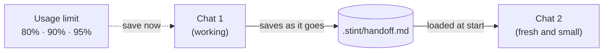

<div align="center">

# stint

**Work in short stints, not marathon chats.**

Use about half the Claude usage for the same work. No loss in quality.

[](https://github.com/mrmajdi/stint/actions/workflows/ci.yml)
[](LICENSE)
[](#claude-code)
[](#other-agents)
[](#privacy)

</div>

---

AI coding agents re-read the whole chat on every message. Long chats get expensive fast. stint keeps chats short. It saves the state of your work in a small note. Each new chat starts from that note, not from a huge history.

| | Before | With stint |
|---|---:|---:|
| Usage for the same 30 days of work | 100% | **47%** |
| Chat history sent with each message (median) | 411k tokens | **97k tokens** |
| Biggest single cache write | 928k tokens | **136k tokens** |

*These numbers come from replaying 30 days of real Claude Code logs from one developer (the author). They are an estimate, not a promise. Run `/stint audit` to see your own numbers.*

## Contents

- [The problem](#the-problem)
- [How stint works](#how-stint-works)
- [Install](#install)
- [Use](#use)
- [The handoff note](#the-handoff-note)
- [Usage limit warnings](#usage-limit-warnings)
- [Works with graphify and ponytail](#works-with-graphify-and-ponytail)
- [Supported agents](#supported-agents)
- [Recommended settings](#recommended-settings)
- [Privacy](#privacy)
- [FAQ](#faq)
- [Development](#development)

## The problem

Your usage limit does not go to your questions or to the code the agent writes. It goes to the **chat history**.

1. **Every message re-sends the whole chat.** In a 400k-token chat, the history part of each message costs 10 times more than in a 40k-token chat.
2. **Coming back after a break is worse.** Claude Code keeps the chat history in a cache: for one hour on a Claude subscription, for five minutes with an API key. After that, your next message writes the whole history into the cache again. One message can use a big part of your 5-hour limit at once.
3. **You cannot see it happen.** The agent cannot see your usage meter either. When the limit stops the chat, your work state is lost.

A 30-day audit of one heavy Claude Code user showed this:

| What the audit found | Value |
|---|---:|
| Usage spent while the chat was over 200k tokens | **88%** |
| Usage spent re-reading and re-caching history | **89%** |
| Usage spent on writing and thinking | 11% |
| Single "welcome back" message after a break | up to **928k tokens** |

Most token-saving tools make the agent write less, or shorten tool output. Here that was only about 11% of the usage. stint works on the other 89%.

## How stint works



stint has four parts:

1. **The handoff note.** The agent keeps a short note in `.stint/handoff.md`: the goal, what is done, decisions, dead ends, next steps and key files. It updates the note while it works, not only at the end.
2. **The start-of-chat hook.** Every new chat gets the note at once. The agent says what it is resuming and continues. You do not need to explain the task again.
3. **Usage limit warnings.** When your 5-hour or weekly limit passes 80%, 90% or 95%, the agent is told to save the note before the limit stops the chat.
4. **The audit.** `/stint audit` reads your local logs and shows where your usage goes. It also shows a before-and-after estimate for your own habits.

The note is a plain file in your project. Codex, Gemini CLI and Cursor can read it too. If you hit your Claude limit, you can continue the same task in another agent.

## Install

### Claude Code

Install the plugin. This is the best way, because it includes the hooks.

```text
/plugin marketplace add mrmajdi/stint
/plugin install stint@stint
```

Start a new chat. stint is active.

**Optional: usage limit warnings.** Claude Code only shares your usage-limit numbers with the status line. To turn the warnings on, add this to `~/.claude/settings.json`:

```json
"statusLine": { "type": "command", "command": "bash ~/.claude/stint/statusline.sh" }
```

The status line then shows `stint · context 34% · 5h 61% · week 42%`. The script is copied to `~/.claude/stint/` each time a chat starts, so the path works after plugin updates. This needs a Pro or Max plan.

### Other agents

```bash
git clone https://github.com/mrmajdi/stint.git
cd stint
./install.sh                          # every agent found on this computer
./install.sh --project ~/code/my-app  # one project: AGENTS.md + Cursor rule
```

| Option | What it installs |
|---|---|
| `--codex` | Skill in `~/.codex/skills/stint` and rules in `~/.codex/AGENTS.md` |
| `--gemini` | Rules in `~/.gemini/GEMINI.md` |
| `--project DIR` | Rules in `DIR/AGENTS.md` and `DIR/.cursor/rules/stint.mdc`. Works for Cursor, Copilot, Windsurf, Zed, Aider and other agents that read `AGENTS.md`. |
| `--claude` | Claude Code without the plugin: skill and rules only, no hooks |
| `--uninstall` | Removes stint from the chosen targets. Your own text in those files stays. |

The installer is safe to run again. It only changes text between `<!-- stint:begin -->` and `<!-- stint:end -->`.

## Use

Most of the time you do nothing. The agent saves the note while it works, and a new chat picks it up.

| Command | What it does |
|---|---|
| `/stint save` | Save the handoff note now. Use it before you stop. |
| `/stint` or `/stint status` | Show the note, and tell you if a fresh chat would be cheaper. |
| `/stint resume` | Read the note and continue. A new chat does this by itself. |
| `/stint done` | Mark the task as finished, so no chat resumes it. |
| `/stint audit` | Show where your usage goes, with a before-and-after estimate. |

In agents without slash commands, just write it: *"stint save"*, *"stint audit"*.

### A normal day

1. Open a chat and work. The agent keeps `.stint/handoff.md` up to date.
2. The task changes, or the chat gets long? Start a new chat.
3. Coming back after lunch, or after your limit resets? Start a **new** chat. Do not continue the old one.
4. The new chat reads the note and says, for example: *"Resuming: password reset form, next is the email step."*

### The audit

```text
$ /stint audit

Where it went
  history reads     70%  █████████████████░░░░░░░
  history writes    19%  █████░░░░░░░░░░░░░░░░░░░
  writing            7%  ██░░░░░░░░░░░░░░░░░░░░░░
  thinking           4%  █░░░░░░░░░░░░░░░░░░░░░░░

How long the chat was when each message was sent
  > 200k            88%  █████████████████████░░░
  median history per message: 411k tokens

Coming back to long chats (≥150k tokens re-cached after ≥60 min away)
  14 calls · 8% of usage · worst: 928k tokens in one call

Before and after (replay of these 30 days with stint habits)
                                     before   with stint
  usage                                100%          47%
  median history per message           411k          97k
  biggest single cache write           928k         136k
  estimated saving: 53%

What to change
  1. 88% of your usage was spent in chats past 200k tokens. Work in short chats ...
  2. 14 times, coming back to a long chat after a break re-cached its whole history ...
```

You can also run it directly: `python3 skills/stint/scripts/audit.py --days 7`.

**How the estimate works.** The audit replays your real logs. The replies and tool output stay the same. Only the history changes: a fresh chat starts when the history passes 150k tokens (`--cap`), or when you come back after 60 minutes or more. Each fresh chat also pays for writing the note and for re-reading 20k tokens of files. Shares use public API price ratios, because Anthropic does not publish how plan limits count each token type.

## The handoff note

The note lives in `.stint/handoff.md` in your project. It has at most 60 lines.

```markdown
# Handoff: password reset
Status: in progress
Updated: 2026-10-24 14:05 by claude-code

## Goal
Users can reset their password by email. Check: `npm test -- reset` passes.

## Done
- Reset token table and API route (`src/api/reset.ts`, tests pass)

## Decisions
- Tokens expire after 30 minutes: security review asked for it

## Dead ends
- Sending email from the API route: too slow, moved to the job queue

## Next steps
1. Write the email job in `src/jobs/reset-email.ts`

## Key files and commands
- `src/api/reset.ts`: reset API
- `npm test -- reset`: reset tests
```

- The agent **overwrites** the note. It does not grow.
- On the first save, stint adds `.stint/` to `.git/info/exclude`. The note stays out of your commits, and your `.gitignore` is not changed. If your team wants to share notes, commit them.
- The agent never writes secrets into the note.

## Usage limit warnings

Claude Code gives usage-limit numbers to the status line only. Hooks do not get them. stint uses both:

1. The stint status line saves your 5-hour and weekly levels to `~/.claude/stint/limits`.
2. Before each of your messages, a small hook reads that file. When a window passes **80%, 90% or 95%**, the agent gets one short message: save the note now.

Each level warns only once per chat. Numbers older than 20 minutes are ignored. The weekly limit is watched the same way as the 5-hour window.

This works on Claude Pro and Max plans in the Claude Code terminal app. If your Claude Code app does not run custom status lines, the warnings stay off. Everything else still works.

## Works with graphify and ponytail

stint works alone. If you also use these tools, it uses them:

| Tool | What stint does with it |
|---|---|
| [graphify](https://github.com/Graphify-Labs/graphify) | When the project has a graph, a new chat runs `graphify update .` and asks the graph first, instead of reading many files again. |
| [ponytail](https://github.com/DietrichGebert/ponytail) | When ponytail is active, the note lists the `shortcut:` comments the agent added, so the next chat knows the deferred work. |

## Supported agents

| Agent | Install | Start-of-chat check | Limit warnings | Status |
|---|---|---|---|---|
| Claude Code | plugin | hook (automatic) | yes, with the status line | tested in live sessions |
| Claude Code | `install.sh --claude` | rule in `CLAUDE.md` | no | installer tested |
| Codex CLI | `install.sh --codex` | rule in `AGENTS.md` | no | installer tested |
| Gemini CLI | `install.sh --gemini` | rule in `GEMINI.md` | no | installer tested |
| Cursor | `install.sh --project` | always-on rule | no | installer tested |
| Copilot, Windsurf, Zed, Aider, others | `install.sh --project` | rule in `AGENTS.md` | no | installer tested |

"Installer tested" means the tests check every file the installer writes. The behavior depends on the agent following its instruction file. Reports and fixes are welcome.

## Recommended settings

These are Claude Code settings. stint works without them, but they help.

- **Compact earlier.** Add `"autoCompactWindow": 300000` to `~/.claude/settings.json`. By default, Opus chats can grow to about 1M tokens before they compact.
- **Give `/goal` an end.** `/goal` keeps working until its condition is true. A vague goal can run for hundreds of turns. Write a check and a limit: `/goal tests in tests/api pass, or stop after 20 turns`.
- **Use a cheaper model for simple work.** Writing plans, emails and documents does not need Opus. Try `/model sonnet`.
- **Do not lower effort to save usage.** In the audit above, thinking was only 4% of the usage. Lower effort costs quality and saves little. Short chats save much more.

## Privacy

- stint runs only on your computer. It sends nothing over the network. There is no telemetry.
- There are no dependencies. stint uses only `bash` and `python3`.
- The audit reads `~/.claude/projects/` and prints totals only. It never prints your prompts or code.
- Files stint writes: `.stint/handoff.md` in your projects, `~/.claude/stint/` (status line copy and limit levels), and the instruction files you choose during install.

## FAQ

**Does a fresh chat lose context?**
The note keeps what matters: goal, decisions, dead ends and next steps. Very long chats also make the agent less focused. A fresh chat with a clear note often works better.

**Why not just use `/compact`?**
Compaction is useful, and stint saves the note after it. But compaction happens late, and its summary is made automatically. It also does not help when you come back after a break and the cache has expired. A note and a fresh chat avoid both problems.

**Does the agent know my usage?**
Not by itself. That is why stint saves the note during the work, and why the limit warnings use the status line.

**I already have a status line. Can I keep it?**
Yes. Send the same input to both scripts, for example:
`"command": "bash -c 'in=$(cat); printf %s \"$in\" | bash ~/.claude/stint/statusline.sh >/dev/null; printf %s \"$in\" | your-status-line-command'"`

**Does it work on Windows?**
It needs `bash`, so use WSL or Git Bash. Native PowerShell support is on the roadmap.

## Uninstall

- Plugin: `/plugin uninstall stint@stint`, then remove the `statusLine` entry if you added it.
- Installer: `./install.sh --uninstall` (add the same options you used to install).
- Handoff notes in `.stint/` folders are yours. stint never deletes them.

## Development

```bash
bash tests/run.sh   # hook, installer and audit tests
```

```text
.claude-plugin/        plugin and marketplace manifests
hooks/                 session-start, limit-watch and status line scripts
skills/stint/          the skill, and scripts/audit.py
rules/stint.md         the always-on rules used by install.sh
install.sh             installer for other agents
tests/                 test suites (bash and Python unittest)
```

CI runs the tests on Linux and macOS, and runs ShellCheck on every script.

### Roadmap

- Native hooks for Codex, Gemini CLI and Cursor
- Audit support for Codex and Gemini logs
- PowerShell version for Windows
- Notes per branch, for parallel work in git worktrees
- A real before-and-after study with more users

Ideas and pull requests are welcome. Please keep the tool small and free of dependencies.

## Credits

stint grew out of a long session of measuring real Claude Code usage. It learned from [graphify](https://github.com/Graphify-Labs/graphify), [ponytail](https://github.com/DietrichGebert/ponytail), [ccusage](https://github.com/ccusage/ccusage) and the [Claude Code docs](https://code.claude.com/docs).

## License

[MIT](LICENSE) © 2026 mrmajdi
